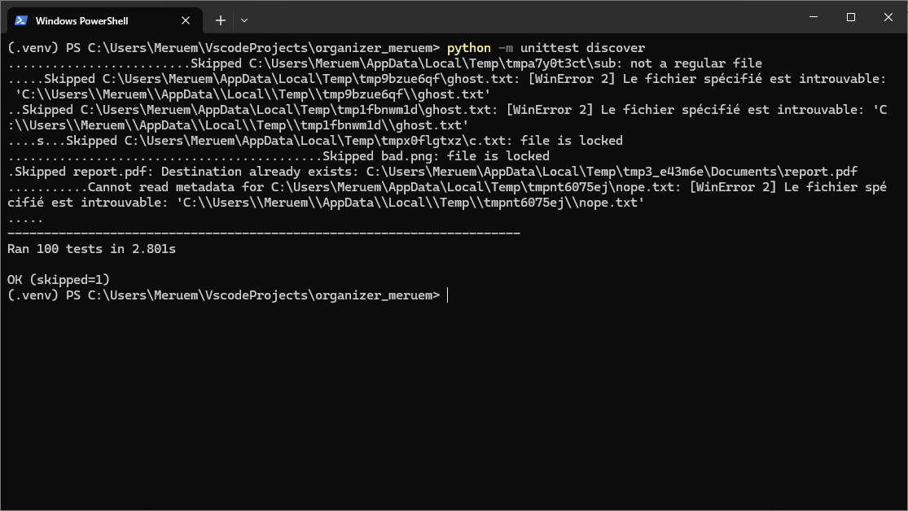
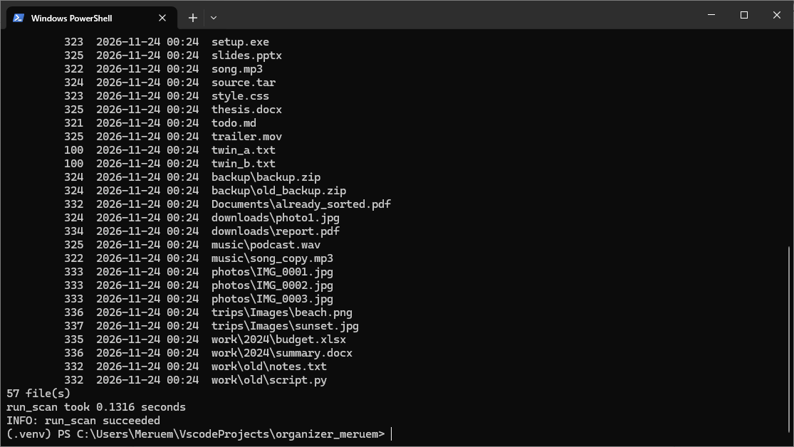
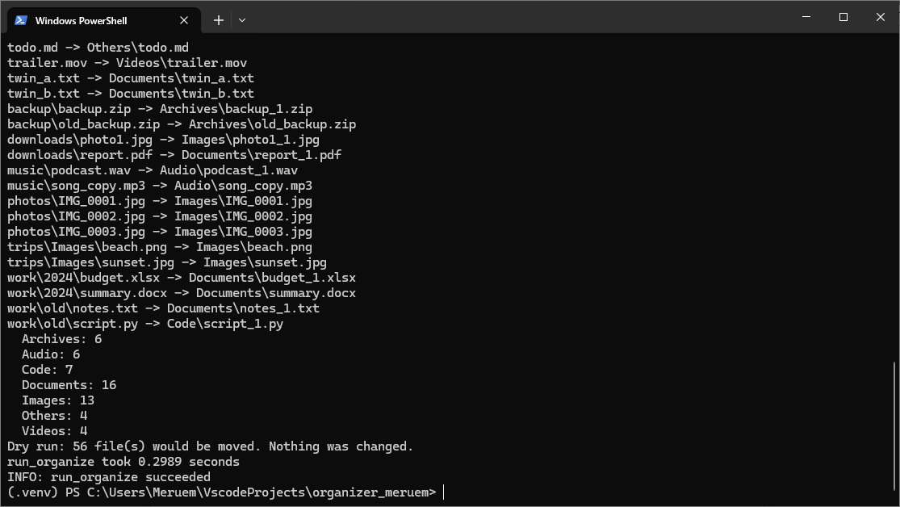
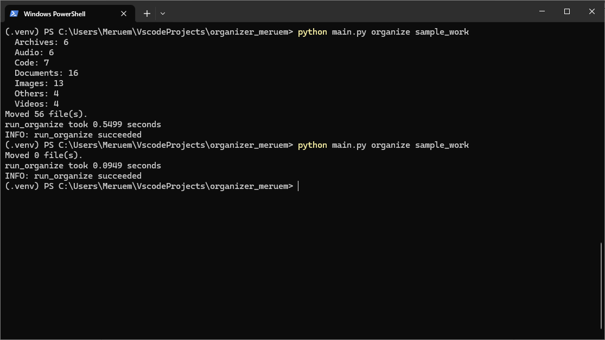
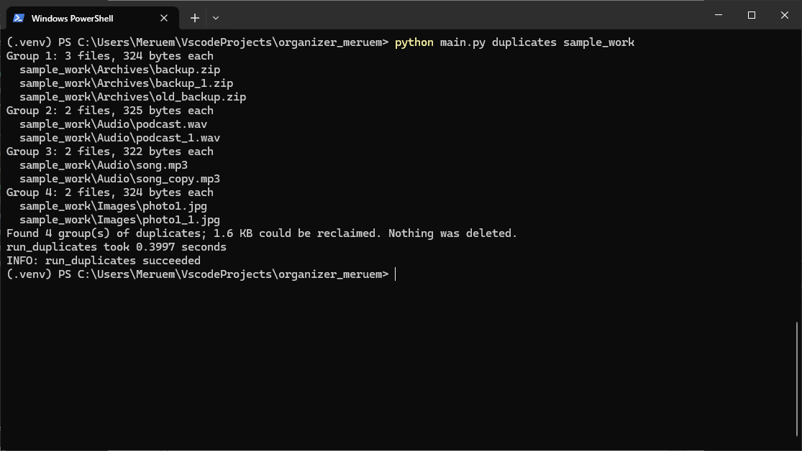
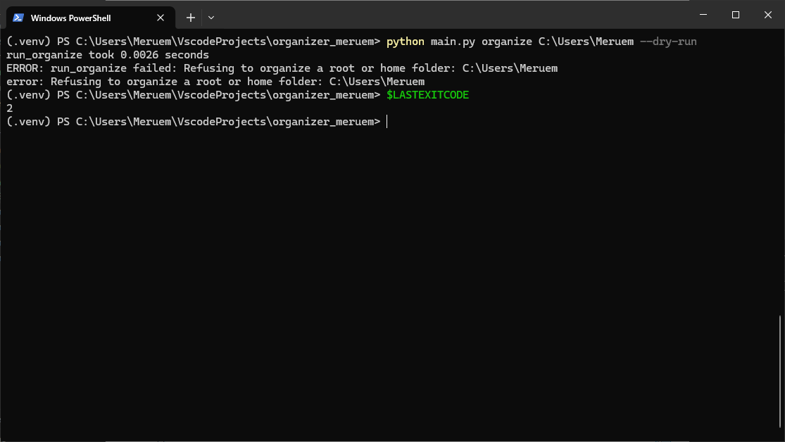

# Smart File Organizer

A command-line tool that scans a folder, sorts its files into category folders
(`Documents`, `Images`, ...) and reports duplicate files. It uses only the Python
standard library.

## Requirements

- Python 3.9 or newer. There is nothing to `pip install`.

## Install

```powershell
git clone <your-repository-url>
cd organizer_meruem
python --version          # must be 3.9 or newer
```

## Usage

```powershell
python main.py scan "C:\Users\You\Downloads"
python main.py organize "C:\Users\You\Downloads" --dry-run
python main.py organize "C:\Users\You\Downloads"
python main.py duplicates "C:\Users\You\Downloads"
```

**Always put a path that contains spaces in quotes**, or the shell splits it into
two arguments. Run `organize --dry-run` first and read the plan before a real run.

| Command | What it does |
| --- | --- |
| `scan DIR` | Lists every file with its size and modification date |
| `organize DIR` | Moves each file into `DIR/<Category>/` |
| `organize DIR --dry-run` | Prints the plan and changes nothing |
| `duplicates DIR` | Reports files with identical content. Never deletes |

| Option | Applies to | Meaning |
| --- | --- | --- |
| `--exclude NAME` | all commands | Also skip folders with this name (repeatable) |
| `--chunk-size BYTES` | `duplicates` | Bytes read per step when hashing (default 1 MB) |
| `-v` | all commands | Debug output. Put it **before** the command |

**Exit codes:** `0` success, `1` finished but some files could not be moved,
`2` could not run (missing folder, refused folder, wrong options).

Results go to stdout, and log and timing lines go to stderr, so
`python main.py duplicates DIR > report.txt` writes a clean report.

## Categories

| Category | Extensions |
| --- | --- |
| Documents | `.pdf` `.docx` `.txt` `.odt` `.xlsx` `.pptx` |
| Images | `.jpg` `.jpeg` `.png` `.gif` `.svg` |
| Audio | `.mp3` `.wav` `.ogg` `.flac` |
| Videos | `.mp4` `.mkv` `.avi` `.mov` |
| Archives | `.zip` `.tar` `.gz` `.rar` |
| Code | `.py` `.js` `.java` `.cpp` `.html` `.css` |
| Others | everything else |

Extensions are matched case-insensitively (`PHOTO.PNG` is an image). Rules are checked
in the order they were registered and the first match wins.

## Safety guarantees

- **Nothing is overwritten.** A name clash becomes `report_1.pdf`, `report_2.pdf`, ...
- **Nothing is deleted.** Duplicates are only reported, and empty folders are left behind.
- **A dry run changes nothing.** It creates no files and no folders.
- **Running twice is safe.** Files already inside a top-level category folder are ignored.
- **One bad file does not stop the run.** Missing or locked files are skipped, reported,
  and make the exit code `1`.
- **Folders and symlinks are never moved or hashed as files.**
- **Application and log folders are skipped:** `AppData`, `.git`, `node_modules`,
  `__pycache__`, `.venv`, `logs`, `log` (case-insensitive). Add more with `--exclude`.
- **Dangerous targets are refused** by `organize`: a drive root or your home folder.

## Add your own category

Custom categories are added through Python, not the command line:

```python
from organizer.classifier import FileClassifier
from organizer.file_organizer import FileOrganizer

classifier = FileClassifier()

@classifier.register_category("Notes")
def is_note(path):
    return path.suffix.lower() == ".md"

organizer = FileOrganizer("C:/path/to/folder", classifier, dry_run=True)
for source, destination in organizer.preview_organization():
    print(source, "->", destination)
```

A category name becomes a folder name, so names with `\ / : * ? " < > |`, leading or
trailing spaces, or the reserved name `Others` are rejected. A custom rule cannot win over
a default rule that matches the same file, because the first registered match wins.

## How it works

```
main.py ──► FileScanner               (finds files; scan_directory() builds the list)
   │
   ├──► FileOrganizer(dir, classifier)    HAS a FileClassifier (composition)
   │        ├── uses FileScanner       to find the files to move
   │        └── uses FileMover         one `with` block per file move
   │
   └──► DuplicateDetector(files)      only reads files, never changes them
```

`@log_operation` and `@measure_execution_time` wrap the command handlers in `main.py`.

## Try it on the sample folder

```powershell
python make_sample.py                          # creates sample_folder\ (62 files)
Copy-Item -Recurse sample_folder sample_work   # work on a copy, keep the original clean
python main.py organize sample_work --dry-run  # 56 files would be moved
python main.py organize sample_work            # moves them
python main.py organize sample_work            # second run: Moved 0 file(s)
python main.py duplicates sample_work          # 4 groups of duplicates
```

Expected: Archives 6, Audio 6, Code 7, Documents 16, Images 13, Others 4, Videos 4;
seven files get a `_1` suffix because of name clashes; the files in `node_modules`,
`logs` and `AppData` and `Documents\already_sorted.pdf` are not touched.

## Screenshots

**Tests pass**



**Scanning the sample folder**



**Dry run: the plan, with nothing changed**



**Real run, Second run moves nothing**



**Duplicate report**



**Refusing a dangerous folder (exit code 2)**



## Run the tests

```powershell
python -m unittest discover -v
```

## Project layout

```
organizer_meruem/
├── main.py                  command line (argparse)
├── make_sample.py           creates the sample folder
├── organizer/
│   ├── scanner.py           FileScanner
│   ├── classifier.py        FileClassifier
│   ├── file_organizer.py    FileOrganizer
│   ├── file_mover.py        FileMover (context manager)
│   ├── duplicate_detector.py  DuplicateDetector
│   └── decorators.py        log_operation, measure_execution_time
├── tests/                   unittest suite
├── sample_folder/           62 demo files
├── docs/screenshots/        terminal screenshots used in this README
├── REPORT.md                answers to the course questions
└── pyproject.toml
```

## Limitations

- There is no undo. Use `--dry-run` first.
- Only files in the folder you name are touched, and empty subfolders remain afterwards.
- Symlinks are skipped, and hard links are reported as duplicates.
- The duplicate report is a snapshot. Re-check files before you delete anything by hand.